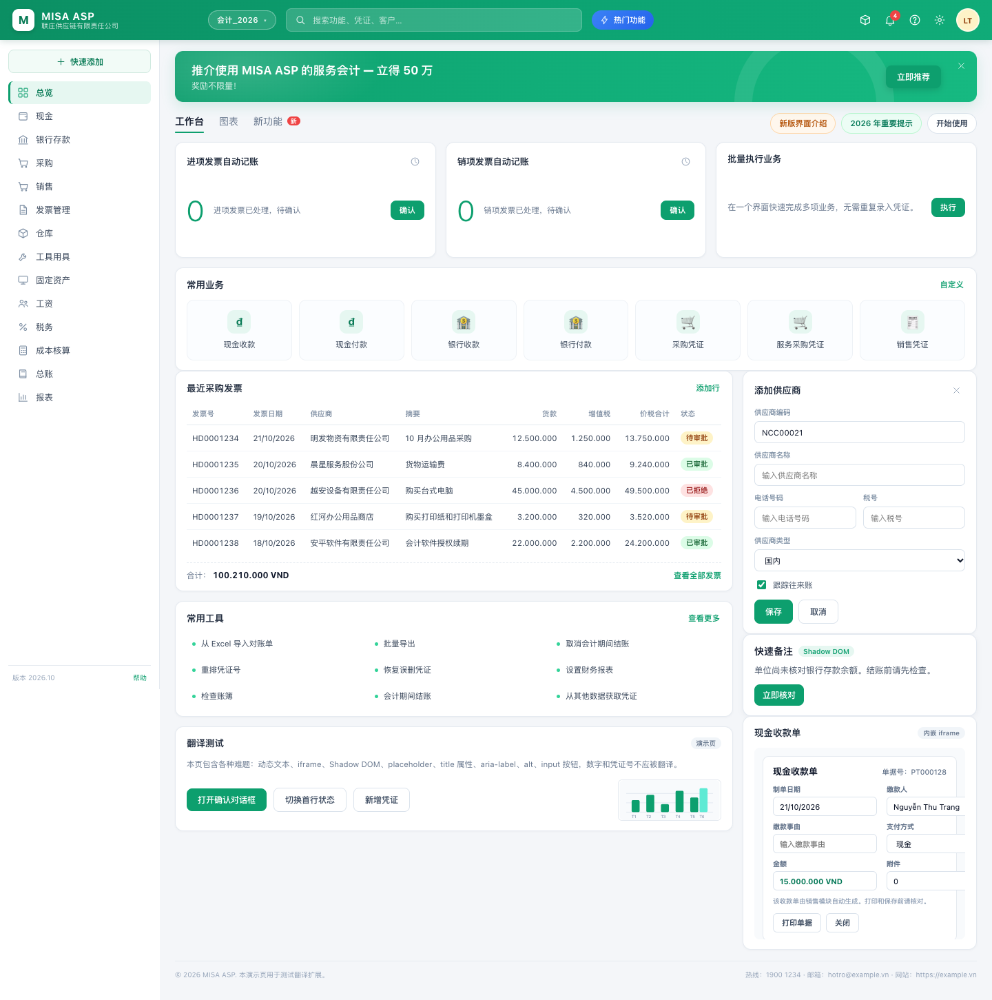
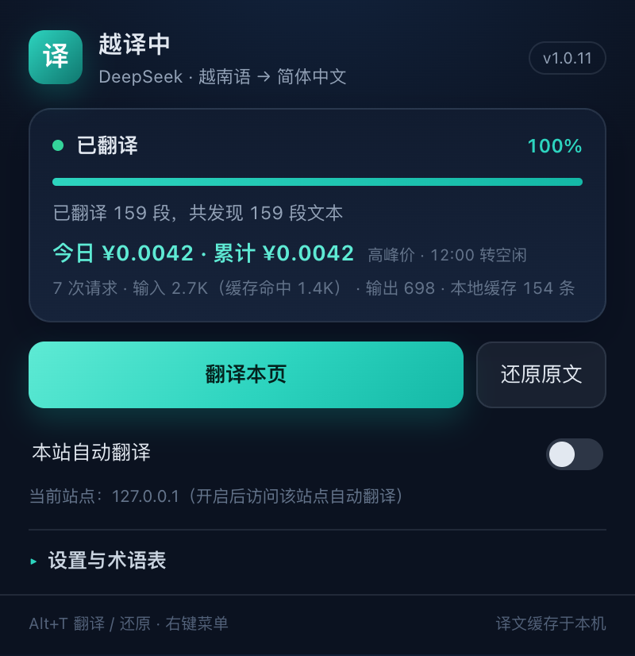
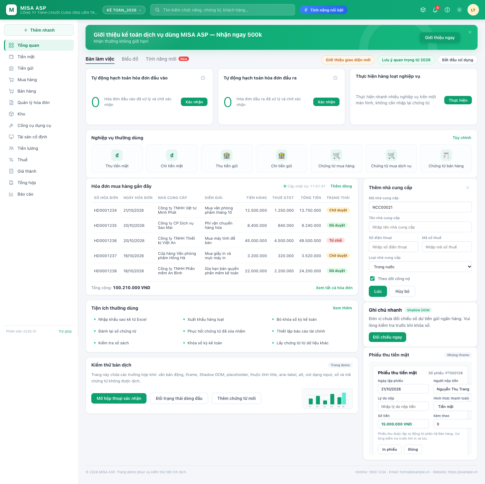

# 越译中 · 网页翻译（DeepSeek）

把越南语网页**整页**翻译成简体中文的 Chrome 扩展（Manifest V3）。专治 Google 自带翻译搞不定的场景：React/Vue 后台里动态渲染的表格、弹窗、iframe、Shadow DOM、placeholder、`title` / `aria-label` / `alt` 提示，以及切换菜单后不断刷新的内容。

默认替换原文，鼠标悬停可看回原文；随时一键还原，不破坏页面结构。





---

## 为什么不用 Google 翻译

以 MISA ASP、KiotViet 这类越南语 SaaS 后台为例，界面上大量文本是：

- 组件挂载后才写入 DOM（Google 翻译抓取时还不存在）；
- 位于 `iframe` 或 `open shadowRoot` 内；
- 只存在于 `placeholder`、`title`、`aria-label`、`alt`、`input[value]` 属性里；
- 列表翻页、弹窗打开后被整块重渲染。

本扩展用「全量遍历 + 动态监听 + 增量翻译」解决：先扫一遍能看到的文本与属性，再用 `MutationObserver` 盯住后续变化；译文按「文本 → 译文」缓存，节点被框架重渲染后立即重新套用，不重复计费。

## 功能

- **整页翻译**：文本节点、`placeholder` / `title` / `aria-label` / `alt`、按钮 `value`、`<title>`、`open` Shadow DOM、同源/跨源 iframe。
- **动态内容**：`MutationObserver` 监听新增节点、文本变化与属性变化；SPA 路由切换、弹窗、翻页后自动补译。
- **越南语优先**：只处理含越南语字符的文本；纯数字、单号（`HD0001234`）、URL、邮箱、代码片段自动跳过。
- **会计术语表**：内置越南语会计/ERP 术语（`Chứng từ` → 凭证、`Hạch toán` → 记账、`Khóa sổ` → 结账……），只把本批命中的术语随请求发送，保证同一术语全站一致；支持自定义术语。
- **本地缓存**：译文写入 `chrome.storage.local`（上限 8000 条），再次打开同一页面零请求。
- **成本可控**：默认每批 24 条、并发 4、单页最多 300 次请求；失败自动二分拆批；429/5xx 指数退避；401/402/403 立即停止并提示。
- **可还原**：弹窗、页面右下角悬浮条、快捷键都能还原原文；悬停译文显示原文。
- **按站点自动翻译**：把当前域名加入白名单，下次打开自动开始。
- **划词翻译**：选中任意文本，点浮出的「译」按钮，就地显示译文，可一键复制。
- **双语对照**：可选「原文 + 译文」上下并列，而不是直接替换；随时切回替换模式。
- **输入框翻译**：在输入框 / 可编辑区域里点「译」，把内容翻译后直接替换，适合回邮件、填备注。
- **译文校正 + 术语记忆**：`Alt + 点击`任意译文可修改；保存后写入本地翻译记忆，同一站点同一原文优先使用你的译法。
- **站点规则**：按域名单独设置翻译模式、站点类型、跳过选择器、专属术语、是否自动翻译 / 禁用。
- **选项页控制台**：站点规则、术语表管理、14 天用量图表、日/月预算、账户余额、模型路由、隐私模式、设置同步与导入导出，都在 `chrome://extensions` →「扩展程序选项」里。
- **多语言源**：自动识别越南语、英语、泰语、印尼语、日语、韩语、老挝语、高棉语等，统一译成中文（也可指定源 / 目标语言）。
- **质量反馈**：修正卡里的「报告问题」会在本地记录原文、译文与站点，方便后续改进。
- **模型路由**：固定模型，或按文本长度 / 站点类型自动在 `deepseek-flash` 与 `deepseek-v4-pro` 之间选择。
- **预算与余额**：设置日/月预算，超限自动停止并提示；可一键查询 DeepSeek 账户余额。
- **隐私模式**：发送前把邮箱、链接、金额、长数字替换为占位符，译文回来后再还原，减少敏感信息外发。
- **更新检查 / 设置同步 / 导入导出**：选项页可检查 GitHub 新版本、用 Chrome 同步跨设备同步设置（不含 API Key）、导出 JSON 备份。

## 安装

1. 打开 Chrome，地址栏输入 `chrome://extensions`，右上角开启「开发者模式」。
2. 点「加载已解压的扩展程序」，选择本项目目录（含 `manifest.json` 的那一层）。
3. 到 [DeepSeek 开放平台](https://platform.deepseek.com/api_keys) 创建 API Key。
4. 点击工具栏中的「译」图标 → 展开「设置与术语表」→ 填入 API Key → **保存设置** → **测试连接**。
5. 打开任意越南语网页，点「翻译本页」，或按 `Alt+T`。

> 扩展需要 Chrome 116+。首次使用自定义中转地址时，Chrome 会弹窗申请该域名的访问权限。

## 使用

| 操作 | 方式 |
| --- | --- |
| 翻译 / 还原 | 点击扩展图标 → 「翻译本页 / 还原原文」；或 `Alt+T`；或右键菜单 |
| 查看原文 | 鼠标悬停在译文上（原生 `title` 提示） |
| 页面内进度 | 右下角悬浮条显示「已翻译 N 段」，可直接点「还原」 |
| 本站自动翻译 | 弹窗中打开「本站自动翻译」开关 |
| 失败提示 | 页面底部红色提示条；弹窗状态卡显示原因 |

### 站点类型自适应

扩展会先判断当前网站属于哪一类，再选择对应的术语与翻译风格：

| 类型 | 典型站点 | 识别依据 |
| --- | --- | --- |
| 财务会计 / ERP | MISA、FAST、BRAVO | 域名，或“凭证 / 记账 / 应收应付”等词 |
| 电商 / 订单 | Shopee、Lazada、Tiki | 订单、购物车、物流、优惠券等词 |
| 招聘 / 人事 | TopCV、VietnamWorks | 候选人、考勤、工资表、劳动合同等词 |
| 资讯 / 内容 | VnExpress、Dân trí | 新闻、专栏、记者等词；标题按中文语感翻译 |
| 教育 / 培训 | Edumall、Topica | 课程、学员、讲义、学费等词 |
| 通用网页 | 其他所有站点 | 兜底，按上下文自然翻译 |

- 识别顺序：域名白名单 → 页面文本领域词打分（至少命中 4 个且明显领先）→ 通用兜底。
- 识别结果会显示在弹窗状态卡里（如“站点类型：财务会计 / ERP”）。
- 自动识别不准时，可在设置里手动指定类型；不同类型使用独立缓存，切换后不会误用旧译文。
- 新增一类站点只需在 `src/shared/sites.js` 的 `PROFILES` 里加一项（域名、领域词、提示词）。

### 设置项

| 字段 | 默认值 | 说明 |
| --- | --- | --- |
| API Key | 空 | 仅保存在本机 `chrome.storage.local` |
| 接口地址 | `https://api.deepseek.com` | 可填中转/代理地址（需 `https://` 或 `http://`） |
| 站点类型 | 自动 | 自动识别网站类型；可手动指定通用/财务/电商/人事/资讯/教育 |
| 模型 | `deepseek-flash` | 可选 `deepseek-v4-pro`（更准、更贵）；翻译会自动关闭思考模式，旧名 `deepseek-chat` / `deepseek-reasoner` 仍兼容 |
| 每批条数 | 24 | 越大请求越少，但单次失败影响面更大（失败会自动拆批） |
| 并发数 | 4 | 同时进行的请求数，可调到 8；越高越快，但更容易触发限流 |
| 单页请求上限 | 300 | 防止超长页面/死循环失控 |
| 悬停显示原文 | 开 | 关闭后不再写入 `title` 提示 |
| 遵循 translate=no | 关 | 默认忽略网页的“不要翻译”标记，后台菜单/顶栏也会翻；开启后尊重网页标记 |
| 自定义术语表 | 空 | 每行 `越南语=中文`，优先级高于内置术语表与模型判断 |
| 跳过选择器 | 空 | 每行一个 CSS 选择器，命中的子树不翻译 |
| 自动翻译站点 | 空 | 由弹窗开关维护，存域名 |

## 工作原理

```
页面 content script（每个 frame 一份）
  ├─ 遍历 DOM / shadowRoot → 收集文本与属性
  ├─ 过滤：越南语判定、代码/URL/单号、skip 选择器、<textarea> 只取属性
  ├─ 分批（16 条 / ≤2600 字符）→ chrome.runtime.sendMessage
  └─ 回写译文；MutationObserver 监听后续变化，命中缓存立即套用
        │
background service worker
  ├─ 术语表过滤 + 组装 prompt（要求严格 JSON：{"translations":[...]}）
  ├─ 缓存命中直接返回；否则 POST /chat/completions
  ├─ 失败二分拆批（最多 3 层）、指数退避、fatal 立即上报
  └─ 按 tab + frame 聚合进度，更新徽标与弹窗状态
```

几个关键设计：

- **翻译单元是「文本」而不是「节点」**：相同文本只请求一次，列表里重复的「Xem chi tiết」只花一条的钱。
- **动态重渲染不重复计费**：每个文本 key 都有本地译文缓存，框架重建 DOM 后直接套用。
- **延迟加载的 iframe**：子 frame 启动时向 background 发 `VI2ZH_FRAME_READY`，若标签页正在翻译则自动加入。
- **高频文本熔断**：亚秒级连续改写的节点（毫秒计时器、倒计时）在 12 次后跳过，避免持续请求；每秒级时钟仍会翻译，重复前缀由 DeepSeek 上下文缓存吸收。
- **严格 JSON + 数量校验**：返回条数不等于请求条数时整批视为失败并拆批，避免错位。
- **保留占位符**：`{0}`、`{{name}}`、`%s`、`<br>`、URL、金额、日期、品牌名（MISA、Excel、VND…）要求原样保留。

## 成本

- 状态卡实时显示「累计 N 次请求 · 输入 X / 输出 Y tokens」。
- 重复文本命中本地缓存，不发请求；重复的 system prompt 会命中 DeepSeek 的上下文缓存。
- 一个 150 段左右的后台页面，首次翻译约 10 批、6k 输入 token；再次打开同一页面为 0 请求。
- 单页 300 次请求硬上限，长页面/异常循环不会无限花钱。

## 隐私

- API Key 与译文缓存只存在本机浏览器存储中，不上传到任何第三方。
- 页面文本仅发送到你自己配置的接口地址（默认 `api.deepseek.com`）。
- 不注入远程脚本，不收集浏览记录，不含统计埋点。
- 隐私模式开启后，邮箱、链接、金额、6 位以上数字会先替换成占位符再发送，译文返回后在本机还原。
- GitHub Actions 每次 push 会跑语法检查、纯逻辑单测与打包（`.github/workflows/ci.yml`），产物在 Actions 的 artifact 里。

## 本地开发与测试

```bash
npm install            # 仅安装 puppeteer-core（不下载浏览器）

npm run test:unit      # 纯逻辑单测（语言/站点/峰谷/清单，不需要浏览器）
npm run mock           # 启动本地 Mock DeepSeek（127.0.0.1:8787）
npm run serve          # 静态服务项目根目录（127.0.0.1:8788），访问 /demo/
npm test               # 端到端测试（自动起 mock + 静态服务）
npm run icons          # 重新生成图标（需要 Pillow）
```

`npm test` 会启动真实的 Chrome for Testing、加载未打包扩展、打开 `demo/` 演示页，用 Mock 接口完成一次完整翻译，并断言：

- 文本节点 / placeholder / title / aria-label / alt / input value 全部翻译；
- `<title>`、Shadow DOM、iframe、动态新增行都被覆盖；
- 数字、单号、URL 不被误翻；
- 还原、二次翻译缓存、弹窗状态、用量统计、无 JS 异常。

需要本机已有 Chrome for Testing：

```bash
CHROME_BIN="/path/to/Chrome for Testing" npm test
```

默认会找 `/tmp/cft/chrome-mac-arm64/...`；也可以用系统 Chrome 的 `--headless=new`，但品牌版 Chrome 可能禁止 `--load-extension`，推荐 Chrome for Testing。

测试产物：`screenshots/demo-vi.png`、`screenshots/demo-zh.png`、`screenshots/popup.png`，以及 `/tmp/vi2zh-e2e.json`。

### 演示页

`demo/` 是一个仿 MISA ASP 的越南语会计后台，专门堆满难题：固定顶栏、侧边菜单、表格、弹窗、`open` Shadow DOM 卡片、`loading="lazy"` 的 iframe、每秒刷新的时钟、每 4 秒切换的状态标签、`input[type=button]`、`alt` 图表、邮箱/URL/单号。它既是测试夹具，也是效果对照：

| 原文 | 译文 |
| --- | --- |
|  |  |

## 译文缓存

翻译结果会写入 `chrome.storage.local` 的 `trCache`，默认最多保留 8000 条，重复文本不再调用 API、也不再计费：

- 同一页面刷新、关掉再开、隔天再来，只要文本没变，都直接命中缓存（整页通常在 1 秒内套用完成）；
- 缓存键由 `模型 + 接口地址 + 术语表 + 原文` 计算，改了其中任何一项都会重新请求，避免用错术语的旧译文；
- 弹窗里会显示「本地缓存 N 条」，设置里的「清空缓存」可随时重置；
- 想让页面一打开就自动翻译，在弹窗里打开「本站自动翻译」——配合缓存，再访问时几乎是瞬时的。

## 用量与费用

弹窗会按 DeepSeek 官方价格实时估算花费：`今日 ¥x · 累计 ¥y`，下面一行是 token 明细（输入、缓存命中、输出）。

- 价格表（元 / 百万 tokens，[官方定价](https://api-docs.deepseek.com/zh-cn/quick_start/pricing/)）：
  | 模型 | 输入（缓存命中） | 输入（未命中） | 输出 |
  | --- | --- | --- | --- |
  | deepseek-flash | 0.02 / 0.04 | 1 / 2 | 4 / 8 |
  | deepseek-v4-pro | 0.15 / 0.30 | 4.5 / 9 | 13.5 / 27 |
  每格为「空闲 / 高峰」价。
- 高峰时段：北京时间周一至周五 09:00–12:00、14:00–18:00；其余时间、周末，以及中国法定节假日全天都按空闲价（高峰价的一半）。
- 2026 年法定节假日已内置（依据[国办发明电〔2025〕7号](https://www.gov.cn/zhengce/zhengceku/202511/content_7047091.htm)）；以后年份需要在 `src/shared/pricing.js` 里更新节假日表。
- 弹窗费用行会显示当前是「高峰价」还是「空闲价」，以及距离切换还有多久（例如「高峰价 · 12:00 转空闲」）。
- 费用按每次请求返回的 `usage` 逐笔累计，保存在 `chrome.storage.local`；「清空缓存」不会清空用量。
- 设置里的「查余额」会调用官方 `/user/balance`，显示账户总余额、赠送与充值部分。
- 这是**估算**：中转服务的实际扣费可能不同，最终以 platform.deepseek.com 账单为准；本扩展只统计自己发出的请求。

## 版本与打包

日常改完代码执行：

```bash
npm run build
```

它会自动把 `manifest.json` 的 patch 版本 +1，把 `manifest.json`、`src/`、`icons/` 同步到 `dist/vi2zh-translator/`，并在上级目录生成 `vi2zh-translator-v<版本>.zip`。

然后在 `chrome://extensions` 点该扩展的「重新加载」即可；弹窗顶部会显示新版本号，看到版本变化就说明更新成功。已经打开的页面需要刷新一次（内容脚本不会注入到已存在的标签页）。只想重新打包、不升版本时用 `node tools/build.js --no-bump`。

## 目录结构

```
vi2zh-translator/
├── manifest.json           MV3 清单
├── src/
│   ├── background.js       Service Worker：请求、缓存、拆批、进度、菜单/快捷键
│   ├── content.js          DOM 遍历、动态监听、HUD、还原
│   ├── popup.html/css/js   弹窗 UI 与设置
│   └── shared/
│       ├── defaults.js     默认设置
│       └── glossary.js     内置越南语会计术语表
├── icons/                  16/32/48/128 图标
├── demo/                   越南语演示页（index / iframe / chart / css）
├── tools/
│   ├── make_icons.py       Pillow 生成图标
│   ├── mock-deepseek.js    本地 Mock DeepSeek（含 140+ 词条）
│   └── e2e.js              Puppeteer 端到端测试 + 截图
└── screenshots/            测试自动生成的截图
```

## 已知限制

- 只做**越南语 → 简体中文**，不翻译其他语种。
- 图片、`<canvas>`、CSS `content` 伪元素里的文字无法翻译。
- `closed` Shadow DOM 无法访问；跨域 iframe 需要其自身 URL 匹配 `http/https`（默认已匹配）。
- 按钮内嵌复杂图标时，译文以纯文本替换，可能丢失图标节点（演示页的 `input` 按钮不受影响）。
- 极短的全大写缩写、含数字的型号可能被判定为「代码」而保留原文。
- API 返回异常时会保留原文并提示，不会写坏页面。

## 常见问题

**页面提示「Extension context invalidated」或「扩展已更新，请刷新页面」？**

这是因为扩展被重新加载、升级或禁用后，已经打开的页面里还跑着旧版内容脚本，它与扩展的运行时连接已经断开。刷新页面（F5）即可恢复；正在翻译的内容会保留已经写入的中文，刷新后重新点翻译会直接命中本地缓存，不会重复扣费。


**翻译到一半停了？**
多半是 API Key 余额/权限问题（401/402/403 会直接停止）。看弹窗状态卡或页面提示条的原因，修好后重新点「翻译本页」即可，已翻译部分会走缓存。

**自定义中转地址保存失败？**
Chrome 需要单独授权该域名，保存时请允许弹窗中的权限请求；`http://localhost` 与 `http://127.0.0.1` 已默认授权。

**页面结构被破坏？**
点「还原原文」会按记录的原文逐条写回，并移除扩展添加的 `title` 提示与悬浮条；若页面已被框架重渲染，刷新一次即可。

**为什么不用 Google 翻译接口？**
本扩展面向「识别不全」的后台页面，需要可控的术语、稳定的 JSON 输出、缓存与成本上限；DeepSeek 的中文表达与术语一致性更适合会计场景。

## 高级设置（选项页）

在 `chrome://extensions` 找到「越译中」→「详情」→「扩展程序选项」，或点弹窗右上角的「选项」：

| 标签 | 内容 |
| --- | --- |
| 翻译设置 | 替换 / 双语模式、固定或自动模型、源语言与目标语言、批量与并发、跳过选择器、划词 / 输入框 / 原文提示 / 隐私模式开关 |
| 站点规则 | 按域名覆盖翻译模式、站点类型、跳过选择器、专属术语、自动翻译、整站禁用 |
| 术语表 | 逐条添加、删除自定义术语（`越南语=中文`），保存在本机 |
| 用量与预算 | 今日 / 本月花费、14 天柱状图、请求与 token、峰谷时段、日/月预算、账户余额、清空缓存 |
| 同步与兼容 | Chrome 同步上传 / 拉取（不含 API Key）、导出 / 导入 JSON、Edge / Firefox 说明 |

> 敏感信息：API Key 只存在本机 `chrome.storage.local`，不会进入同步或导出文件。
